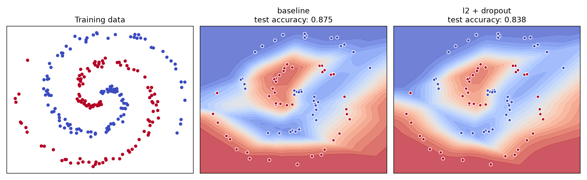

# Deep Learning Lab

Small, reproducible experiments for understanding neural networks from first principles. The implementation is original and uses NumPy rather than course notebooks or copied assignment code.

## What this project demonstrates

- a two-layer neural network with explicit forward and backward propagation;
- numerically stable binary cross-entropy and sigmoid calculations;
- He initialization, L2 regularization, and inverted dropout;
- finite-difference gradient checking;
- a reproducible experiment on noisy spiral data;
- unit tests and GitHub Actions CI.

## Result



The experiment compares an unregularized baseline with an L2 + dropout model. On this small synthetic split, regularization slightly reduces test accuracy: a useful example of the bias-variance tradeoff rather than a claim that regularization always improves a model.

## Run locally

```bash
python -m venv .venv
source .venv/bin/activate
python -m pip install -e ".[dev]"
pytest -q
python experiments/spiral_regularization.py
```

The experiment prints final loss and test accuracy, then regenerates `results/spiral_regularization.png`.

## Repository structure

```text
src/deep_learning_lab/   model and synthetic dataset
experiments/             reproducible experiment entry point
tests/                   gradient and learning checks
results/                 generated visualization
```

## Scope and limitations

- Full-batch gradient descent keeps the implementation readable; it is not optimized for large datasets.
- Dropout is active only during training.
- The synthetic dataset is useful for debugging nonlinear decision boundaries, not for benchmarking production models.

## Background

This project was created after studying neural-network fundamentals, regularization, gradient checking, TensorFlow, CNNs, ResNets, and object detection. It intentionally reimplements a small problem independently instead of publishing graded course solutions.
